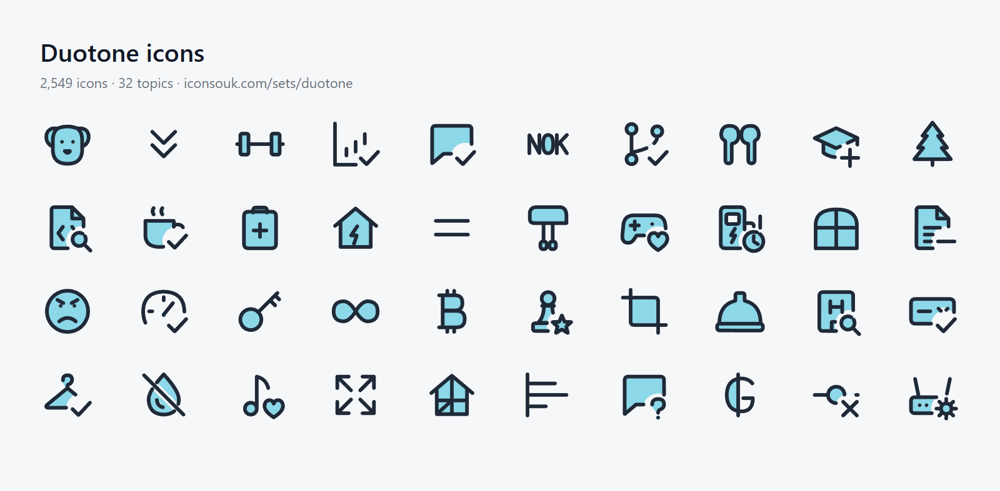

# Duotone icons

2,549 free duotone icons by [Novissium](https://novissium.com): a clear outline plus a soft accent colour.

Browse, search and download on **[iconsouk.com/sets/duotone](https://iconsouk.com/sets/duotone/)** – also as React, Vue and CSS.



## Usage

- `viewBox="0 0 24 24"`. The outline uses `currentColor` and takes the text colour of its surroundings.
- The accent colour is a CSS variable – change it for all icons with one line:

```css
svg { --isk-accent: #ff7a59; }
```

- Without the variable the accent is cyan (`#22B8D8`).

Icons are sorted by topic:

```
svg/animals/bear.svg
svg/interface/search.svg
```

## Topics

Animals, arrows, buildings, charts, communication, currency, development, devices, education, events, files, food, health, house, interface, kitchen, light, media, mobility, nature, office, people, science, security, shapes, shop, sport, text, tools, travel, wear and weather.

## More icons

58,000+ free icons in 33 sets on [iconsouk.com](https://iconsouk.com)

## License

The icons in this repository are licensed under [Creative Commons Attribution 4.0 International (CC BY 4.0)](https://creativecommons.org/licenses/by/4.0/).

You may use, share and adapt them, also commercially, as long as you give credit:

> Icons: Duotone from iconsouk.com – by Novissium (novissium.com)
